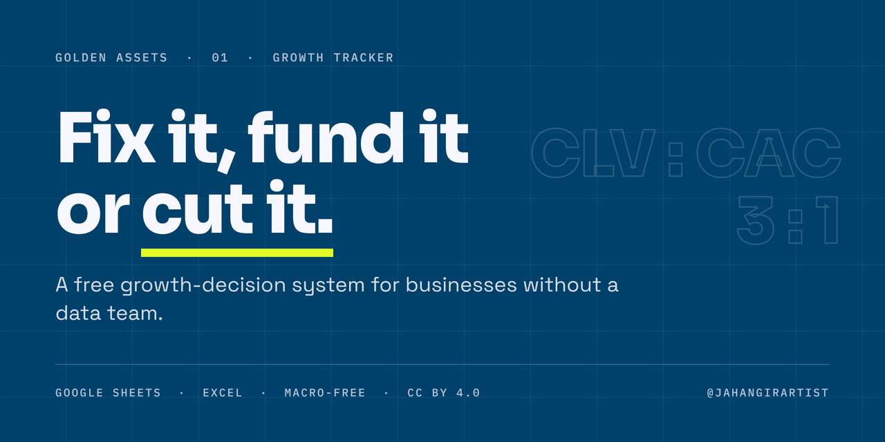

# Golden Assets: Growth Tracker

**Fix it, fund it or cut it.** A free growth-decision system for businesses without a data team. Enter your numbers once a week; the workbook rolls them into months and financial years and shows which lever to pull next.

**[Make a copy in Google Sheets →](https://docs.google.com/spreadsheets/d/11-2A87uPZr-QUbUQQxuYErQ721AnZ8fN/copy)** · [Download the .xlsx (v1.0)](https://github.com/jahangirartist/golden-assets-growth-tracker/releases/latest) · [Read the case study](https://jahangirartist.framer.website/projects/golden-assets-growth-tracker)

---

## Why it exists

Large companies see their numbers every morning, because BI teams pull the data from their systems automatically. Most small and mid-sized businesses don't work that way. Sales sit in a ledger, orders in a messaging inbox, ad spend on a separate screen. With no single view, three leaks go unnoticed:

- **Churn hides behind new sign-ups.** When growth is read as customers at the end of the month minus customers at the start, every cancellation is masked by a new order.
- **"Cheap" channels aren't cheap.** Boosted posts look efficient until team time, tools and agency fees are counted.
- **Green lights appear on empty data.** Many free templates show verdicts before a single real number goes in, so the dashboard looks decisive while the business learns nothing.

The cost is budget moved on instinct: more money into acquisition when the real problem is keeping the customers already won. This tracker is a finance discipline, not a dashboard design: one place to open each week and leave with a decision.

## What it decides

- **Whether you are ready to scale.** A growth readiness gate checks NPS, the 40% product-market-fit test, churn and CLV : CAC before the dashboard recommends more acquisition spend.
- **Which channels to keep.** Paid CAC and payback over the last 12 months give each channel a verdict: Scale, Optimise or Cut.
- **Whether the unit economics work.** Fully loaded CAC, CLV : CAC and payback in months, calculated from your entries rather than typed in.
- **What to test next.** An experiment backlog ranked by ICE score, reviewed in a weekly sprint log.

## How it works

**Weekly entry → monthly roll-up → financial-year summary.** You fill one row a week. Each week counts in the month that holds its fourth day, the months roll up across 24 months, and the Yearly Summary totals each financial year from the start month you set (July by default, matching Bangladesh's July–June financial year).

| Tab | What it does | When |
|---|---|---|
| Start Here | Six-step setup, tab map, colour legend and the ranges to clear | Once |
| Dashboard | One-page view: 12 vital signs, readiness gate, AARRR snapshot, OKRs, experiment engine and six rolling 12-month charts | Daily glance |
| Settings | Company model, week start, financial year, North Star, targets and benchmarks | Quarterly |
| North Star & OKRs | North Star three-test check, input metric tree and quarterly OKRs with red, yellow and green status | Weekly |
| Weekly Metrics | The data engine: one row per week for acquisition, customers, revenue, referral, cost and North Star | Weekly |
| Monthly Metrics | Rolls the weeks into 24 months and calculates every metric | Automatic |
| Yearly Summary | Week vs last week, month to date, financial year to date, and each financial year | Weekly, yearly |
| AARRR Funnel | Pirate-metric scorecard, funnel volumes and the quarterly lever board | Monthly |
| Channels | Spend and customers by channel, paid CAC, CLV : CAC, payback and verdicts | Monthly |
| Experiments | Backlog with hypotheses, ICE scoring, test log, decisions and failure causes | Weekly |
| Sprint Log | Record of the weekly growth meeting | Weekly |
| NPS & PMF | Survey waves on the 0–10 NPS scale and the 40% PMF test | Per survey |
| Cohorts | Retention by sign-up month, with heatmap and average curve | Monthly |
| Health Check | Lifecycle focus, readiness gate, PMF signals and growth-culture scorecard | Quarterly |
| Lean Canvas | One-page business model, linked to your North Star | Quarterly |
| Customer Map | Two personas and a journey map | Quarterly |
| Formula Sheet | Every formula, its rule of thumb and where it is calculated | Reference |
| Chart Data | Rolling 12 months behind the Dashboard charts | Never edit |

## Set up in six steps

1. **Settings.** Enter your company details, currency, first month, week start day, financial-year start month, gross margin, lifecycle stage and North Star. Review every target.
2. **Replace the sample data.** Clear the input ranges listed on Start Here, re-enter the two opening balances, then set Data mode to Live.
3. **Every week.** Fill the next row in Weekly Metrics, in order, with no gaps.
4. **Monthly close.** Fill that month's column in Channels and Cohorts, plus any survey in NPS & PMF.
5. **Monday and quarterly.** Update Experiments and the Sprint Log every Monday. Each quarter, run the OKR review and refresh Lean Canvas, Customer Map and Health Check.
6. **Read the results.** Pick the report month on the Dashboard, and a week on the Yearly Summary.

## Accuracy rules built in

- **Churn** is customers lost ÷ customers at the start, not (start − end) ÷ start, which hides cancellations behind new sign-ups.
- **NPS** uses the 0–10 scale: promoters 9–10, passives 7–8, detractors 0–6.
- **CAC** comes in two kinds. Fully loaded CAC includes team, tools and agency cost; paid CAC by channel does not. The workbook never compares them directly.
- **Revenue retention** is shown monthly and annualised, because published NRR benchmarks are usually annual.
- **No verdicts on empty data.** Status cells read "Awaiting data" until real inputs exist.

Every definition is listed in [docs/formulas.md](docs/formulas.md) and in the workbook's Formula Sheet tab.

## Built to be checked

- 18 tabs, 4,607 formulas and zero errors in the released file. No macros.
- Built for Google Sheets. The .xlsx uses only standard spreadsheet functions, so it also opens in Excel.
- The sample figures belong to a fictional company (Example Co.). Replace them before use, and don't quote or screenshot them as proof.
- It is a growth-decision tool, not bookkeeping. It does not track cash flow.

## বাংলাদেশি ব্যবসার মালিকদের জন্য: ৩ ধাপে শুরু

১. উপরের **Make a copy** থেকে নিজের ফ্রি কপি নিন, তারপর Settings-এ নিজের টার্গেট বসান। 
২. নমুনা ডেটা মুছে প্রতি সপ্তাহের সংখ্যা দিন। 
৩. Dashboard-এ মাস বেছে নিন, আর এই মাসের একটা সিদ্ধান্ত নিন।

নিজে সেট করার সময় না থাকলে লিখুন: jahangirartist.x@gmail.com

## Credits and licence

**Methods credited:** Net Promoter Score to Fred Reichheld (Bain & Company); the PMF survey and ICE scoring to Sean Ellis; AARRR to Dave McClure; OKRs to Andy Grove, popularised by John Doerr; Lean Canvas to Ash Maurya. The workbook design, formulas and sample model are original.

**Licence:** [CC BY 4.0](LICENSE). Free to use, adapt and share, including commercially, as long as the credit stays with the workbook.

**No warranty:** provided as is. Check each definition against your own finance and reporting rules before using the numbers in decisions.

---

Built by **[Jahangir Alam](https://github.com/jahangirartist)**, Brand & Communications Lead (MBA, Finance), Dhaka. Part of **Golden Assets**, free systems for businesses without a data team. See also the [30-Day ICE Content Calendar](https://github.com/jahangirartist/golden-assets-ice-content-calendar).
